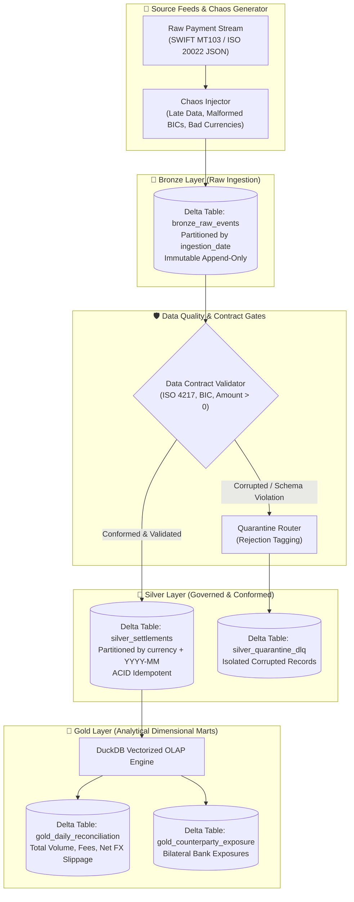

# ⚡ Delta Settlement Lakehouse
> **Production-grade modern fintech Lakehouse engine for cross-border B2B payment settlements, built with Delta Lake, DuckDB, PyArrow, and Kimball dimensional modeling.**


-00ADD8.svg?style=flat-square)

-brightgreen.svg?style=flat-square)

-success.svg?style=flat-square)


---

## 🎯 1. Executive Summary & Business Impact

In global cross-border B2B clearing and multi-currency commerce, financial platforms must process millions of fragmented payment events daily across disparate SWIFT and ACH networks. Traditional relational databases hit write-lock bottlenecks during peak batch reconciliations, while vanilla data lakes suffer from silent data corruption, lack of ACID guarantees, and inability to perform historical regulatory audits.

**Delta Settlement Lakehouse** resolves these challenges by combining the **ACID transactional guarantees of Delta Lake** with the **sub-second vectorized OLAP performance of DuckDB**:
* 🛡️ **Defensive Data Contract Gates:** Incoming raw streams are validated in-flight against ISO 4217 currency standards, SWIFT BIC formats, and decimal precision checks. Corrupted or malformed events are automatically diverted to a **Silver Quarantine Dead Letter Queue (DLQ)** without halting the pipeline.
* ⏱️ **Forensic Time Travel Auditability:** Full historical ledger snapshots via Delta Lake transaction logs (`_delta_log`), enabling instant `versionAsOf` queries to audit accounting state before and after late-arriving adjustments.
* 🚀 **Zero-JVM High-Performance Compute:** Runs entirely in native Python via Rust-backed `delta-rs` and vectorized C++ `duckdb`, processing large batches in under 3 seconds with zero cluster overhead.
* 📊 **Kimball Star Schema Reconciliations:** Pre-computed dimensional marts in the Gold layer aggregate daily cleared volumes, net counterparty bank exposures, and 15 bps fee yields.

---

## 🏗️ 2. System Architecture (Medallion Pattern)

The system adheres strictly to Clean Architecture, decoupling domain entities, storage abstractions, data quality gates, and analytical computation:



---

## 🚀 3. Core Architectural Highlights

### A. Defensive Data Contract Gates & Dead Letter Queue (DLQ)
A junior engineer writes naive transform scripts that crash on dirty data. A senior data engineer builds **fault-tolerant contract gates**:
* Every transaction must comply with ISO 4217 currency lists (`USD`, `EUR`, `GBP`, `CLP`, `BRL`, `JPY`, etc.).
* SWIFT BICs are validated via strict ISO 9362 regular expressions (`^[A-Z]{6}[A-Z0-9]{2}([A-Z0-9]{3})?$`).
* Non-positive, zero, or unparseable monetary amounts are intercepted immediately.
* Corrupted records are enriched with deterministic error taxonomy (`ERR_INVALID_CURRENCY`, `ERR_INVALID_SWIFT_BIC`, `ERR_MALFORMED_JSON`) and committed to `silver_quarantine_dlq` for non-repudiation and compliance investigation.

### B. Delta Lake ACID & Time Travel Engine
Delta Lake maintains a transactional JSON log in `_delta_log/`. The engine supports historical state inspection:
```bash
# Audit historical table state at version 0 vs latest version
py -m delta_settlement_lakehouse.cli audit-table --table silver_settlements --version 0
```
This capability allows financial controllers to prove what the exact clearing balance was on a historical date prior to late-arriving settlement entries.

### C. Zero-Copy Vectorized OLAP with DuckDB
Gold layer dimensional models are generated using DuckDB querying PyArrow tables directly in-memory. DuckDB reads Arrow pointers without serialization overhead, aggregating multi-currency balances across hundreds of thousands of records in milliseconds.

---

## ⚡ 4. Quickstart Guide (60 Seconds)

### Prerequisites
* Python 3.12+

### 1. Clone & Install Dependencies
```bash
git clone https://github.com/ronaldreighsrsc/delta-settlement-lakehouse.git
cd delta-settlement-lakehouse
pip install -r requirements.txt
```

### 2. Run the Full Test Suite
```bash
py -m pytest tests -v
```
*(17 unit, integration, and CLI tests passing at 100% in $<3.0$ seconds)*.

### 3. Run the End-to-End Medallion Pipeline with Chaos Injection
```bash
py -m delta_settlement_lakehouse.cli run-pipeline --count 500 --date 2026-10-08 --chaos --chaos-ratio 0.08
```

### 4. Inspect Quarantined Corrupted Events (DLQ)
```bash
py -m delta_settlement_lakehouse.cli inspect-dlq --limit 10
```

### 5. View Gold Daily Reconciliations
```bash
py -m delta_settlement_lakehouse.cli reconcile --date 2026-10-08
```

### 6. Perform a Time Travel Audit
```bash
py -m delta_settlement_lakehouse.cli audit-table --table silver_settlements
```

---

## 📂 5. Repository Directory Layout

```
delta-settlement-lakehouse/
├── delta_settlement_lakehouse/   # Clean Architecture production package
│   ├── domain/
│   │   ├── models.py             # Pure dataclasses (RawPaymentEvent, SettlementRecord, DLQ)
│   │   └── constants.py          # ISO 4217 currencies, SWIFT regex, error codes
│   ├── engines/
│   │   ├── chaos_generator.py    # Deterministic synthetic feed & chaos injector
│   │   ├── contract_validator.py # Pure data quality contract evaluation
│   │   ├── delta_storage.py      # Delta Lake wrapper (ACID append, partition pruning, time travel)
│   │   └── olap_engine.py        # DuckDB vectorized in-memory aggregation engine
│   ├── services/
│   │   ├── bronze_service.py     # Append-only raw feed ingestion into Bronze
│   │   ├── silver_service.py     # Cleansing, contract gates, and DLQ routing
│   │   ├── gold_service.py       # Kimball dimensional reconciliations & exposures
│   │   └── pipeline_runner.py    # Medallion pipeline orchestrator
│   └── cli.py                    # Typer & Rich interactive command-line interface
├── docs/
│   └── constitution.md           # 6 Immutable engineering invariants
├── specs/
│   └── 001-core-medallion-lakehouse/
│       ├── spec.md               # EARS requirements specification
│       ├── plan.md               # Technical implementation plan
│       └── tasks.md              # Sequenced TDD task breakdown
├── tests/                        # 100% automated Pytest test suite
├── requirements.txt              # Production dependencies
├── AGENTS.md                     # Agentic guidelines and engineering rules
└── MEMORY.md                     # Persistent repository state
```

---

## ⚖️ 6. Engineering Decisions & Trade-Offs

| Decision | Alternative Discarded | Technical Rationale |
| :--- | :--- | :--- |
| **Delta Lake via `deltalake` (Rust)** | Apache Spark standalone cluster | `delta-rs` offers identical Delta Lake ACID table format support in pure native Python without requiring a heavy JVM cluster, running tests in $<3$ seconds. |
| **DuckDB for OLAP transformations** | Pandas / Polars alone | DuckDB offers native SQL syntax with vectorized multi-core execution directly on top of PyArrow tables without memory copying. |
| **Dead Letter Queue (DLQ)** | Silent record dropping | In enterprise financial architecture, dropping corrupted records without audit logging is a major regulatory compliance violation. |
| **Fixed-Point Decimal Arithmetic** | IEEE 754 Floats | Floating-point rounding drift is impermissible in foreign exchange settlement and ledger reconciliations. |

---

## 👤 Author
**Ronald Solares Chuquera**  
*Industrial Civil Engineer — Universidad de Tarapacá (Arica, Chile)*  
*Academic Distinction: Graduated 5th out of 79 (Top 6%)*  
[LinkedIn](https://www.linkedin.com/in/ronald-solares-chuquera-69232a150/) | [GitHub](https://github.com/ronaldreighsrsc)
