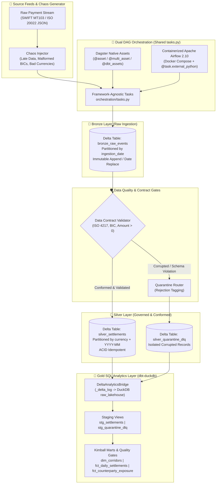

# ⚡ Delta Settlement Lakehouse
> **Production-grade modern fintech Lakehouse engine for cross-border B2B payment settlements, built with Delta Lake, DuckDB, PyArrow, and Kimball dimensional modeling.**


-00ADD8.svg?style=flat-square)


-brightgreen.svg?style=flat-square)

-success.svg?style=flat-square)


---

## 🎯 1. Executive Summary & Business Impact

In global cross-border B2B clearing and multi-currency commerce, financial platforms must process millions of fragmented payment events daily across disparate SWIFT and ACH networks. Traditional relational databases hit write-lock bottlenecks during peak batch reconciliations, while vanilla data lakes suffer from silent data corruption, lack of ACID guarantees, and inability to perform historical regulatory audits.

**Delta Settlement Lakehouse** resolves these challenges by combining the **ACID transactional guarantees of Delta Lake** with the **sub-second vectorized OLAP performance of DuckDB**:
* 🛡️ **Defensive Data Contract Gates:** Incoming raw streams are validated in-flight against ISO 4217 currency standards, SWIFT BIC formats, and decimal precision checks. Corrupted or malformed events are automatically diverted to a **Silver Quarantine Dead Letter Queue (DLQ)** without halting the pipeline.
* ⏱️ **Forensic Time Travel Auditability:** Full historical ledger snapshots via Delta Lake transaction logs (`_delta_log`), enabling instant `versionAsOf` queries to audit accounting state before and after late-arriving adjustments.
* 🚀 **Zero-JVM High-Performance Compute:** Runs entirely in native Python via Rust-backed `delta-rs` and vectorized C++ `duckdb`, processing large batches in under 3 seconds with zero cluster overhead.
* 📊 **Kimball Star Schema & Modular dbt SQL Marts:** Dimensional analytics (`dim_corridors`, `fct_daily_settlements`, `fct_counterparty_exposure`) built cleanly with `dbt-duckdb`, declarative YAML schema tests, and singular financial reconciliation assertions.
* 🔗 **Dual Orchestration (Dagster SDA + Containerized Apache Airflow):** Shared pure task primitives (`orchestration/tasks.py`) power both native Dagster `@asset`/`@dbt_assets` lineage and a containerized **Apache Airflow 2.10 (`LocalExecutor` + PostgreSQL)** TaskFlow DAG (`@dag` / `@task.external_python`).

---

## 🏗️ 2. System Architecture (Medallion Pattern + dbt + Dagster & Airflow)

The system adheres strictly to Clean Architecture, decoupling domain entities, storage abstractions, data quality gates, declarative SQL marts, and multi-orchestrator DAG execution:



---

## 🚀 3. Core Architectural Highlights

### A. Defensive Data Contract Gates & Dead Letter Queue (DLQ)
A junior engineer writes naive transform scripts that crash on dirty data. A senior data engineer builds **fault-tolerant contract gates**:
* Every transaction must comply with ISO 4217 currency lists (`USD`, `EUR`, `GBP`, `CLP`, `BRL`, `JPY`, etc.).
* SWIFT BICs are validated via strict ISO 9362 regular expressions (`^[A-Z]{6}[A-Z0-9]{2}([A-Z0-9]{3})?$`).
* Non-positive, zero, or unparseable monetary amounts are intercepted immediately.
* Corrupted records are enriched with deterministic error taxonomy (`ERR_INVALID_CURRENCY`, `ERR_INVALID_SWIFT_BIC`, `ERR_MALFORMED_JSON`) and committed to `silver_quarantine_dlq` for non-repudiation and compliance investigation.

### B. Delta Lake ACID & Time Travel Engine
Delta Lake maintains a transactional JSON log in `_delta_log/`. The engine supports historical state inspection:
```bash
# Audit historical table state at version 0 vs latest version
py -m delta_settlement_lakehouse.cli audit-table --table silver_settlements --version 0
```
This capability allows financial controllers to prove what the exact clearing balance was on a historical date prior to late-arriving settlement entries.

### C. Zero-Copy Vectorized OLAP with DuckDB & Modular `dbt` Marts
Gold layer dimensional models are transformed declaratively in SQL (`dbt-duckdb`) directly over PyArrow-hydrated Delta snapshots (`DeltaAnalyticsBridge`), enforcing schema contracts (`not_null`, `unique`, `accepted_values`) and financial parity invariants (`assert_reconciled_silver_parity.sql`) on every build.

### D. Dual DAG Orchestration (Dagster SDA + Containerized Apache Airflow)
`delta_settlement_lakehouse/orchestration/tasks.py` isolates pure Medallion task callables so both orchestrators share a single tested implementation:
* **Dagster Native Assets:** Coordinates Bronze ingestion, Silver/DLQ contract validation, and downstream `@dbt_assets` natively on Windows/Linux.
* **Apache Airflow 2.10 (Docker Compose):** Runs `settlement_medallion_dag` with PostgreSQL `LocalExecutor` and `@task.external_python` isolating Lakehouse/`dbt-core` dependencies in `/opt/lakehouse_venv` (zero `protobuf` dependency conflicts with Airflow's control plane).

---

## ⚡ 4. Quickstart Guide (60 Seconds)

### Prerequisites
* Python 3.12+

### 1. Clone & Install Dependencies
```bash
git clone https://github.com/ronaldreighsrsc/delta-settlement-lakehouse.git
cd delta-settlement-lakehouse
pip install -r requirements.txt
```

### 2. Run the Full Test Suite
```bash
py -m pytest tests -v
```
*(32 unit, integration, dbt SQL, Dagster DAG, Airflow AST/Docker contract, and CLI tests passing at 100%)*.

### 3. Run the End-to-End Orchestrated DAG (Dagster + dbt-duckdb)
```bash
py -m delta_settlement_lakehouse.cli orchestrate --count 100 --date 2026-10-08 --chaos --chaos-ratio 0.08
```
*(Optional visual Dagster UI lineage explorer: `dagster dev -m delta_settlement_lakehouse.orchestration.definitions`)*

### 4. Run Direct Medallion Pipeline with Chaos Injection
```bash
py -m delta_settlement_lakehouse.cli run-pipeline --count 500 --date 2026-10-08 --chaos --chaos-ratio 0.08
```

### 5. Inspect Quarantined Corrupted Events (DLQ)
```bash
py -m delta_settlement_lakehouse.cli inspect-dlq --limit 10
```

### 6. View Gold Daily Reconciliations
```bash
py -m delta_settlement_lakehouse.cli reconcile --date 2026-10-08
```

### 7. Perform a Time Travel Audit
```bash
py -m delta_settlement_lakehouse.cli audit-table --table silver_settlements
```

### 8. Run Containerized Apache Airflow (Docker Compose + PostgreSQL)
```bash
docker compose build
docker compose up -d postgres
docker compose run --rm airflow-init
docker compose run --rm --no-deps airflow-scheduler airflow dags test settlement_medallion_dag 2026-10-28
# Or launch the full UI & scheduler stack at http://localhost:8080 (admin / admin via .env.example):
docker compose up -d airflow-webserver airflow-scheduler
```

---

## 📂 5. Repository Directory Layout

```
delta-settlement-lakehouse/
├── airflow/
│   └── dags/
│       └── settlement_medallion_dag.py # Airflow 2.10 TaskFlow DAG (@dag / @task.external_python)
├── dbt_analytics/                # Modular dbt-duckdb SQL analytics project
│   ├── dbt_project.yml           # Materializations (staging views, marts tables)
│   ├── profiles.yml              # DuckDB connection isolated via LAKEHOUSE_DUCKDB_PATH
│   ├── models/
│   │   ├── staging/              # sources.yml, schema.yml, stg_settlements.sql, stg_quarantine_dlq.sql
│   │   └── marts/                # dim_corridors.sql, fct_daily_settlements.sql, fct_counterparty_exposure.sql
│   └── tests/                    # Singular SQL invariants (positive amounts & Silver parity)
├── delta_settlement_lakehouse/   # Clean Architecture production package
│   ├── domain/
│   │   ├── models.py             # Pure dataclasses (RawPaymentEvent, SettlementRecord, DLQ)
│   │   └── constants.py          # ISO 4217 currencies, SWIFT regex, error codes
│   ├── engines/
│   │   ├── chaos_generator.py    # Deterministic synthetic feed & chaos injector
│   │   ├── contract_validator.py # Pure data quality contract evaluation
│   │   ├── delta_storage.py      # Delta Lake wrapper (ACID append, partition pruning, time travel)
│   │   ├── olap_engine.py        # DuckDB vectorized in-memory aggregation engine
│   │   └── dbt_bridge.py         # Delta -> DuckDB Arrow hydration & programmatic dbtRunner bridge
│   ├── services/
│   │   ├── bronze_service.py     # Append-only raw feed ingestion into Bronze
│   │   ├── silver_service.py     # Cleansing, contract gates, and DLQ routing
│   │   ├── gold_service.py       # Kimball dimensional reconciliations & exposures
│   │   └── pipeline_runner.py    # Medallion pipeline runner
│   ├── orchestration/
│   │   ├── tasks.py              # Shared framework-agnostic Medallion tasks (Dagster + Airflow)
│   │   ├── assets.py             # Dagster Bronze, Silver/DLQ @multi_asset, and @dbt_assets
│   │   └── definitions.py        # Dagster Definitions & run_orchestrated_pipeline entrypoint
│   └── cli.py                    # Typer & Rich interactive command-line interface
├── docs/
│   └── constitution.md           # 6 Immutable engineering invariants
├── specs/
│   ├── 001-core-medallion-lakehouse/
│   ├── 002-dbt-analytics-and-dag-orchestration/
│   └── 003-airflow-container-dag/
├── tests/                        # 100% automated Pytest test suite (32 tests)
├── Dockerfile.airflow            # Custom Airflow 2.10.5 image with isolated /opt/lakehouse_venv
├── docker-compose.yml            # Postgres 16 + Airflow LocalExecutor stack
├── .env.example                  # Documented local container credentials template
├── requirements.txt              # Production dependencies
├── AGENTS.md                     # Agentic guidelines and engineering rules
└── MEMORY.md                     # Persistent repository state
```

---

## ⚖️ 6. Engineering Decisions & Trade-Offs

| Decision | Alternative Discarded | Technical Rationale |
| :--- | :--- | :--- |
| **Delta Lake via `deltalake` (Rust)** | Apache Spark standalone cluster | `delta-rs` offers identical Delta Lake ACID table format support in pure native Python without requiring a heavy JVM cluster. |
| **Dual Orchestration (Dagster + Airflow Docker)** | Single framework lock-in | Dagster powers native Windows/Linux SDAs while containerized Apache Airflow (`LocalExecutor` + PostgreSQL) delivers industry-standard scheduled workflows backed by one shared `tasks.py` module. |
| **Isolated `@task.external_python` Venv** | Monolithic pip install inside Airflow | Isolates `dbt-core` (`protobuf>=6`) from Airflow's runtime (`opentelemetry protobuf<5`) cleanly via `/opt/lakehouse_venv` with zero dependency conflicts. |
| **`dbt-duckdb` over Delta Bridge** | Monolithic Python SQL strings | Decouples Kimball SQL marts (`dim_*`, `fct_*`), declarative YAML schema checks, and singular reconciliation invariants into testable analytics-engineering artifacts. |
| **Dead Letter Queue (DLQ)** | Silent record dropping | In enterprise financial architecture, dropping corrupted records without audit logging is a major regulatory compliance violation. |
| **Fixed-Point Decimal Arithmetic** | IEEE 754 Floats | Floating-point rounding drift is impermissible in foreign exchange settlement and ledger reconciliations. |

---

## 👤 Author
**Ronald Solares Chuquera**  
*Industrial Civil Engineer — Universidad de Tarapacá (Arica, Chile)*  
*Academic Distinction: Graduated 5th out of 79 (Top 6%)*  
[LinkedIn](https://www.linkedin.com/in/ronald-solares-chuquera-69232a150/) | [GitHub](https://github.com/ronaldreighsrsc)
