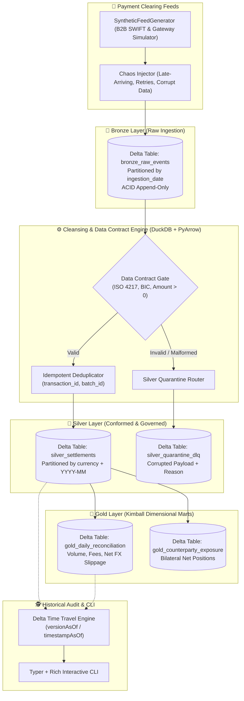

# Technical Implementation Plan — Spec 001: Core Medallion Lakehouse Engine

**Status:** approved  
**Spec:** [spec.md](./spec.md)  
**Project:** `delta-settlement-lakehouse`  

---

## 1. System Architecture & Component Diagram



---

## 2. Directory Layout & Module Responsibilities

```
delta_settlement_lakehouse/
├── domain/
│   ├── models.py             # Pure dataclasses / Pydantic schemas (PaymentRecord, RawEvent, ReconciledBatch)
│   └── constants.py          # ISO 4217 currencies, SWIFT regex, error codes
├── engines/
│   ├── contract_validator.py # Pure evaluation logic for data quality gates
│   ├── chaos_generator.py    # Synthetic multi-currency B2B generator with deterministic seed
│   ├── delta_storage.py      # Delta Lake wrapper (write_deltalake, read, vacuum, time travel)
│   └── olap_engine.py        # DuckDB vectorized queries over Delta/Arrow tables
├── services/
│   ├── bronze_service.py     # Ingests raw batch into bronze Delta table
│   ├── silver_service.py     # Cleanses bronze, routes to silver & DLQ
│   ├── gold_service.py       # Computes reconciliation & exposure marts
│   └── pipeline_runner.py    # End-to-end Medallion pipeline orchestrator
└── cli.py                    # Typer + Rich command-line application
```

---

## 3. Storage Layer & Table Schemas

### Bronze: `bronze_raw_events`
* `event_id`: string (UUID)
* `batch_id`: string (UUID)
* `ingested_at_utc`: timestamp
* `ingestion_date`: string (`YYYY-MM-DD`, partition key)
* `source_feed`: string
* `raw_payload`: string (JSON)

### Silver: `silver_settlements`
* `transaction_id`: string (UUID)
* `batch_id`: string (UUID)
* `timestamp_utc`: timestamp
* `sender_bic`: string (8-11 chars)
* `receiver_bic`: string (8-11 chars)
* `settlement_currency`: string (3 chars, partition key)
* `settlement_amount`: double / decimal
* `target_currency`: string (3 chars)
* `booked_fx_rate`: double / decimal
* `target_amount`: double / decimal
* `settlement_year_month`: string (`YYYY-MM`, partition key)
* `reconciliation_hash`: string (SHA256)

### Silver: `silver_quarantine_dlq`
* `event_id`: string (UUID)
* `batch_id`: string (UUID)
* `quarantined_at_utc`: timestamp
* `rejection_reason`: string
* `raw_payload`: string (JSON)

### Gold: `gold_daily_reconciliation`
* `settlement_date`: string (`YYYY-MM-DD`)
* `currency`: string (3 chars)
* `total_settled_amount`: double
* `transaction_count`: int
* `total_fees_collected`: double
* `avg_fx_rate`: double
* `computed_at_utc`: timestamp

---

## 4. Technical Decisions & Trade-Offs

| Decision | Alternative Discarded | Rationale |
| :--- | :--- | :--- |
| **Delta Lake via `deltalake` (Rust)** | PySpark standalone cluster | `delta-rs` runs in pure Python with Rust backend; 0 MB JVM overhead, sub-second unit tests, identical Delta table compatibility. |
| **DuckDB for OLAP transformations** | Pandas | DuckDB processes millions of rows vectorially using multi-threading with zero RAM copying over PyArrow datasets. |
| **Dead Letter Queue (DLQ) in Delta** | Discarding corrupted rows | Real financial systems require full non-repudiation and auditability for failed records. |
| **Deterministic Chaos Seed** | Pure random Faker data | Essential for reproducible integration tests, CI/CD, and repeatable demos for recruiters. |

---

## 5. Automated Test Strategy
* `tests/test_domain_models.py`: Validation rules and models.
* `tests/test_contract_validator.py`: Contract gates (valid vs. corrupted inputs).
* `tests/test_delta_storage.py`: ACID writes, schema enforcement, time travel reading.
* `tests/test_pipeline_medallion.py`: End-to-end Bronze $\rightarrow$ Silver $\rightarrow$ Gold flow.
* `tests/test_cli_smoke.py`: Typer CLI command invocation and Rich table rendering.
